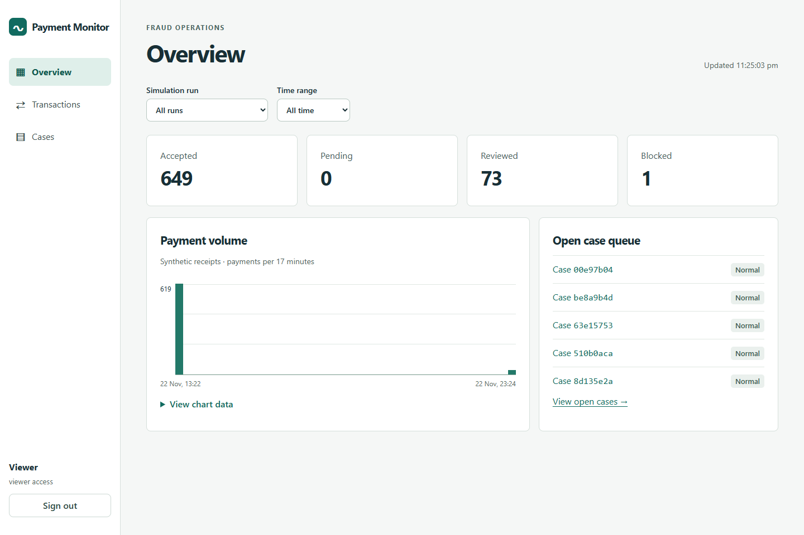

# Real-Time Payment Fraud Detection Platform

A local fraud investigation workspace for synthetic payments. Follow a payment from receipt to a model decision, inspect the features behind its score, and track an analyst's response to a flagged transaction.

## Features

- Generate repeatable synthetic payments and watch approvals, reviews and blocks appear in the Transactions screen.
- Inspect the feature snapshot, model version, thresholds and signed contributions stored with each decision.
- Browse cases as a viewer. As an analyst, take ownership, record notes and resolve a case with an audit trail.
- Track receipt throughput, scoring latency, consumer lag and quarantine activity in Grafana.

## Architecture and stack

The Python simulator sends payments to FastAPI. PostgreSQL commits each receipt with an outbox entry. A relay publishes it to Kafka. The worker retrieves account history from Redis or PostgreSQL, computes the versioned features, and scores the payment with XGBoost. It commits the decision, explanation and any case to PostgreSQL before advancing the consumer offset.

The React and TypeScript client reaches the API through Nginx. Prometheus collects service metrics for Grafana. Docker Compose runs the stack locally.

## First-time setup

Start Docker Desktop with Linux containers enabled. In PowerShell, from the repository root, run the commands below. The first build requires internet access. Initialization creates private local credentials. Training creates a checksummed booster and manifest in the model volume and registers the active version in PostgreSQL.

~~~powershell
.\scripts\init.ps1
docker compose build tools web
docker compose --profile observe pull db redis kafka prometheus grafana
docker compose up -d --wait db redis kafka
docker compose run --rm tools migrate
docker compose run --rm tools topics
docker compose run --rm tools seed-users
docker compose run --rm tools train --seed 42 --rows 100000
docker compose --profile observe up -d --no-build --wait api relay worker web prometheus grafana
docker compose --profile observe ps
~~~

Open [Payment Monitor](http://127.0.0.1:3000). Retrieve the generated viewer and analyst logins privately:

~~~powershell
docker compose run --rm --entrypoint cat tools /credentials/local-users.json
~~~

Open [Grafana](http://127.0.0.1:3001/d/payments-local/payment-operations) as admin. Retrieve its password with `docker compose exec -T grafana cat /var/lib/grafana/admin-password`. Keep credentials out of screenshots and commits.

## Run a simulation

Open **Transactions**, then run the showcase in a second PowerShell window:

~~~powershell
docker compose run --rm tools simulate --scenario showcase --count 200 --rate 2 --seed 42
~~~

The simulator submits approximately two payments per second. Pick a new seed for another batch. Select a transaction to inspect its decision. Open **Cases** for payments sent to review or blocked. Copy the run ID printed by the simulator and substitute it below to compare accepted, decided, pending and failed totals.

~~~powershell
docker compose run --rm tools reconcile --run-id <run-id>
~~~

[Mobile case detail](docs/screenshots/mobile-case.png) · [Operations dashboard](docs/screenshots/dashboard.png)

## Operations and validation

After a restart, run `docker compose --profile observe up -d --wait db redis kafka api relay worker web prometheus grafana`. Stop with `docker compose --profile observe down` to retain the named volumes. Use the same private environment file and Compose project name when resuming an installation.

Run `docker compose run --rm tools check model` to verify scoring parity and artifact integrity. Run `.\scripts\recovery.ps1` for the isolated crash and outage tests, then `.\scripts\benchmark.ps1` separately for the load test. A prior local benchmark accepted and decided 2,400 synthetic payments at 20 per second with 718 ms p95 receipt-to-commit latency.

## Roadmap

- Evaluate model performance on additional time periods and monitor changes in review workload and block precision.
- Prepare a hosted viewer demonstration with HTTPS and deployment-specific origin settings.
