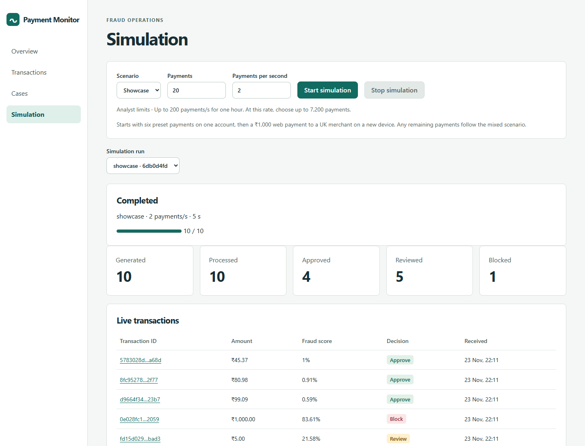

# Real-Time Payment Fraud Detection Platform

Generate synthetic INR payments in a browser, watch a real XGBoost model score them, and investigate flagged transactions in an analyst workspace. Each decision retains its feature snapshot, model version, thresholds and signed SHAP contributions.



## Explore the workspace

- **Simulation** starts and stops a stream, tracks accepted and processed counts, and links each receipt to its decision. **Mixed** samples mostly everyday payments with occasional higher-risk patterns. **Showcase** starts with six preset examples and a cross-border web payment on a new device, then continues with Mixed traffic.
- **Transactions** exposes the fraud score, classification thresholds and the features that increased or decreased model log-odds. Expand technical details for exact inputs, contributions, bias and raw margin.
- **Cases** opens investigations for reviews and blocks. Viewers have read access. Analysts can take ownership, add notes and resolve cases with an audit trail.
- **Overview and Grafana** show payment activity, case queues, decision latency, consumer lag and quarantine activity. [Overview](docs/screenshots/desktop-overview.png) · [Mobile case detail](docs/screenshots/mobile-case.png) · [Grafana dashboard](docs/screenshots/dashboard.png)

## Architecture

The React and TypeScript client reaches FastAPI through Nginx. The browser simulator and CLI share a Python generator. PostgreSQL records a receipt and an outbox event in one transaction. A relay publishes that event to Kafka. The worker reads account history from Redis with a PostgreSQL fallback, computes 12 versioned features, runs XGBoost inference, and commits the decision and explanation before advancing its Kafka offset. Replay protection prevents duplicate decisions. Prometheus and Grafana provide monitoring. Docker Compose runs the nine services locally.

## Run locally

Use Docker Desktop with Linux containers and PowerShell. From the repository root, initialize a fresh installation:

```powershell
.\scripts\init.ps1
docker compose build tools web
docker compose --profile observe pull db redis kafka prometheus grafana
docker compose up -d --wait db redis kafka
docker compose run --rm tools migrate
docker compose run --rm tools topics
docker compose run --rm tools seed-users
docker compose run --rm tools train --seed 42 --rows 100000
docker compose --profile observe up -d --no-build --wait api relay worker web prometheus grafana
```

Open [Simulation](http://127.0.0.1:3000/simulation), choose **Showcase**, request 20 payments at 2 per second, and select **Start simulation**. Click a transaction to inspect its score. Stop ends generation while accepted receipts finish processing.

Guests and viewers can request up to 200 payments at 1–10 per second, with six starts per ten minutes per browser or client address. Analysts can request up to 200 per second and one hour of scheduled traffic. These are configuration limits. Actual throughput depends on the host. One web run can be active at a time.

For viewer or analyst access, read the generated logins privately with `docker compose run --rm --entrypoint cat tools /credentials/local-users.json`. [Grafana](http://127.0.0.1:3001/d/payments-local/payment-operations) uses its own admin password, available through `docker compose exec -T grafana cat /var/lib/grafana/admin-password`.

For an existing installation, reuse its private environment file and Compose project name. After updating the source, rebuild and migrate before restarting:

```powershell
docker compose build tools web
docker compose up -d --wait db redis kafka
docker compose run --rm tools migrate
docker compose --profile observe up -d --no-build --wait api relay worker web prometheus grafana
```

## Verified results

Two 20-second local tests measured receipt-to-decision-commit latency using synthetic payments. All 400 payments received decisions.

| Offered rate | Decisions | Measured decisions/s | Mean latency | p95 latency |
| --- | ---: | ---: | ---: | ---: |
| 5/s | 100/100 | 5.03 | 80.8 ms | 129.9 ms |
| 15/s | 300/300 | 15.00 | 81.1 ms | 123.6 ms |

On a chronological synthetic holdout of 15,000 payments, average precision was **0.496** against **0.0188** fraud prevalence, and ROC-AUC was **0.931**. Reviews and blocks caught 209 of 282 positives. Block precision was **72.9%** (51 of 70), below the 80% target.

To reproduce functional checks, run `docker compose run --rm tools check model` and `docker compose run --rm tools check pipeline`. The pipeline test checks live scoring, evidence parity and Kafka replay. For a repeatable CLI demo, run `docker compose run --rm tools simulate --scenario showcase --count 20 --rate 2 --seed 42`.

## Roadmap

**Project 2 — Agentic Fraud Investigation Copilot** will build on the four read-only evidence views for case evidence, entity relationships, analyst notes and decision contributions. The [view schemas](docs/release/view-schemas.json), [synthetic fixture](docs/release/copilot-fixture.json) and [HTTP API contract](docs/openapi-v1.json) provide the integration boundary.

For EC2, the [production deployment guide](docs/ec2-deployment.md) covers the optional Caddy HTTPS override, origin and cookie settings, private services, and volume-preserving upgrades and rollback. The base Compose configuration continues to target localhost.
